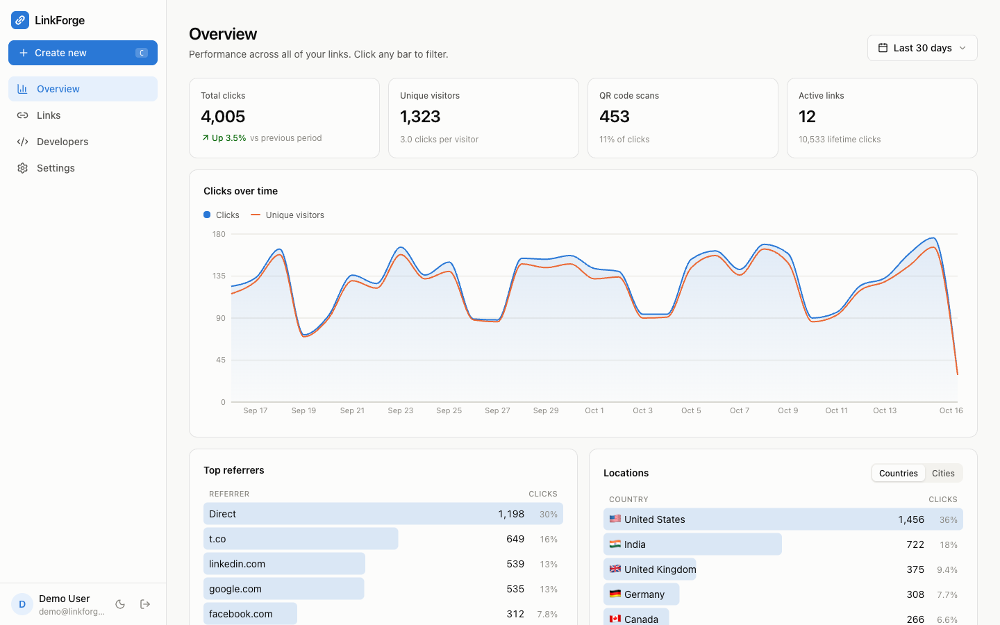
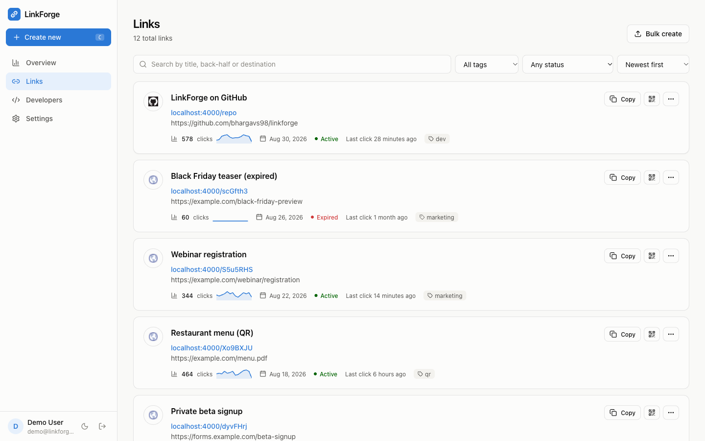
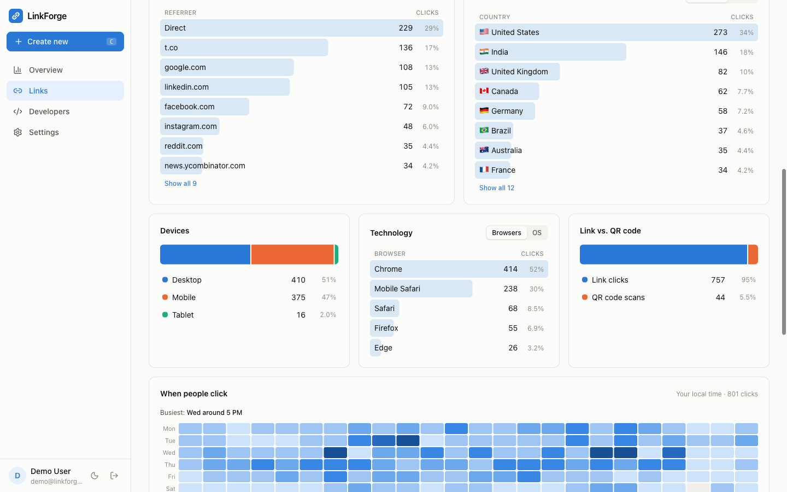
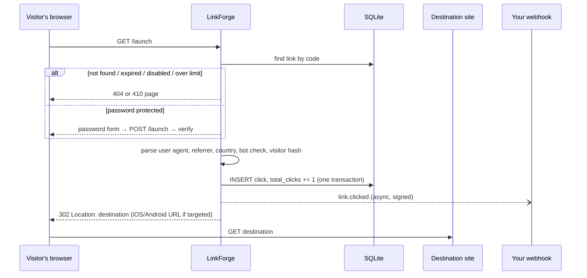
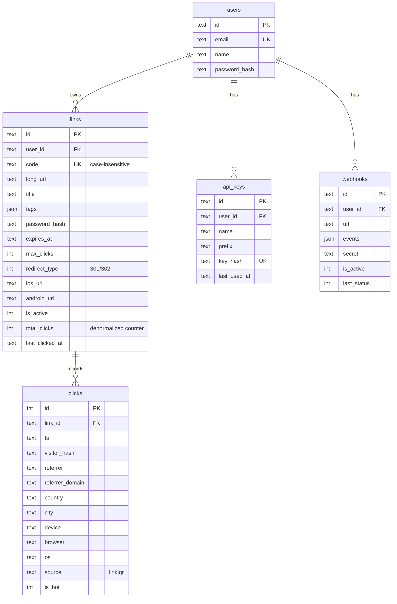

# LinkForge

**A self-hostable URL shortener with real-time click analytics, QR codes, a REST API, webhooks and an interactive dashboard.** Think bit.ly's paid tier (custom back-halves, link analytics, QR codes, API, UTM builder, password-protected and expiring links, device targeting) that you run yourself, as one Node.js process backed by SQLite: a local file on your own server, or [Turso](https://turso.tech) (hosted SQLite) on serverless platforms like Vercel.



<table>
<tr>
<td></td>
<td></td>
</tr>
</table>

---

## Contents

1. [Features](#features)
2. [Quick start (local)](#quick-start-local)
3. [How it works: the concepts](#how-it-works-the-concepts)
4. [Architecture and project layout](#architecture-and-project-layout)
5. [Data model](#data-model)
6. [Using the REST API](#using-the-rest-api)
7. [Integrating into another repo (SDK)](#integrating-into-another-repo-sdk)
8. [Webhooks](#webhooks)
9. [Configuration](#configuration)
10. [Deployment](#deployment)
11. [Testing](#testing)
12. [Security notes](#security-notes)
13. [Scaling and roadmap](#scaling-and-roadmap)

---

## Features

| Area | What you get |
|---|---|
| **Short links** | Random 7-character codes (no look-alike characters), or a **custom back-half** (`/launch`). Rename the back-half or change the destination later without breaking anything you already shared. |
| **Link controls** | **Password protection**, **expiry date**, **click limit**, **301 vs. 302** redirects, enable/disable, **tags**, title. |
| **Device targeting** | Send iOS visitors to the App Store and Android visitors to Google Play; everyone else gets the main URL. |
| **UTM builder** | Adds `utm_source/medium/campaign/term/content` to the destination without overwriting UTM parameters that are already there. |
| **QR codes** | PNG or SVG in any color and size. QR scans are **counted separately** from link clicks. |
| **Analytics** | Total clicks, unique visitors, QR scans, change vs. the previous period, clicks over time (hour/day/week/month), referrers, countries, cities, devices, browsers, operating systems, link vs. QR, and a weekday × hour heatmap. Raw click log and **CSV export**. |
| **Interactive dashboard** | Click any bar (a country, referrer, device...) to **filter the whole report** to it. Date-range picker, chips to show/remove filters, URL-synced state (copy the URL to share the exact view), live auto-refresh, dark mode, mobile layout, `C` shortcut to create a link. |
| **Bulk** | Paste up to 500 URLs in the dashboard, or `POST /links/bulk`. You get a result for every item; one bad URL doesn't fail the batch. |
| **Developer API** | REST + JSON, API keys, OpenAPI 3.1 spec, **Swagger UI at `/api/docs`**, consistent errors, rate limiting, CORS enabled. |
| **SDK** | Zero-dependency TypeScript client (`sdk/`) for Node, Bun, Deno, edge runtimes and browsers. |
| **Webhooks** | HMAC-signed POSTs on `link.clicked`, `link.created`, `link.updated` and `link.deleted`. |
| **Privacy** | Raw IP addresses are never stored. Visitors are identified by a salted, daily-rotating hash. Bots are detected and excluded from counts. |
| **Link preview** | Add `+` to any short link (`/launch+`) to see where it goes without visiting it, just like bit.ly. |

---

## Quick start (local)

Requirements: **Node.js 20+** (22 recommended) and npm.

```bash
git clone https://github.com/bhargavs98/linkforge.git
cd linkforge
npm install
cp server/.env.example server/.env     # defaults work for local dev
npm run seed                           # optional: demo account + ~90 days of fake clicks
npm run dev
```

| What | URL |
|---|---|
| Dashboard | http://localhost:5173 |
| Short links (redirects) | http://localhost:4000/&lt;code&gt; |
| REST API | http://localhost:4000/api/v1 |
| Interactive API docs (Swagger) | http://localhost:4000/api/docs |

If you ran the seed, log in with **`demo@linkforge.dev` / `demo12345`**. The seed prints a ready-to-use API key. Otherwise click **Sign up**.

Try it out:

```bash
# 1. Create a link (paste the API key from the seed output or from Developers → API keys)
export LF_KEY=lf_xxxxxxxx
curl -s -X POST http://localhost:4000/api/v1/links \
  -H "Authorization: Bearer $LF_KEY" -H "Content-Type: application/json" \
  -d '{"url":"https://example.com/a/very/long/path","custom_code":"hello"}'

# 2. Follow it as an iPhone user coming from Twitter in Germany
curl -I http://localhost:4000/hello \
  -A "Mozilla/5.0 (iPhone; CPU iPhone OS 17_0 like Mac OS X) Safari/604.1" \
  -H "Referer: https://t.co/abc" -H "CF-IPCountry: DE"

# 3. The click is already in the dashboard (it refreshes on its own every 15-30 seconds)
```

> In development the dashboard (Vite, port 5173) and the API (Express, port 4000) run separately, and Vite forwards `/api` to Express. In production one process serves everything on one port. See [Deployment](#deployment).

---

## How it works: the concepts

### 1. What a URL shortener does

A shortener is a **lookup table plus a redirect**. You store `code → destination`, and when someone requests `https://your.domain/code`, the server looks up the code and replies with an HTTP redirect (`302 Found` + `Location: <destination>`). The browser then goes to the destination on its own. Because every visit passes through your server first, you can **record the click** before you send the visitor on. That is where the analytics come from.



### 2. Generating short codes

- Codes come from `nanoid` with a **57-character alphabet**: base62 minus `0 O 1 l I`, so a code read aloud or retyped from print still works.
- 7 characters give 57⁷ ≈ **1.95 trillion** combinations. The server picks a random code, checks that it's free and retries if it isn't (collisions are vanishingly rare). Random codes, unlike sequential IDs, also mean nobody can list all your links by counting upward.
- **Custom back-halves** must be 3-64 characters from `[A-Za-z0-9_-]`. They are **case-insensitive and unique** (`/Launch` and `/launch` are the same link). Words the app itself uses (`api`, `app`, `login`, `docs`...) are reserved.

### 3. 301 vs. 302

| | 302 (default) | 301 |
|---|---|---|
| Meaning | "Temporarily here" | "Moved permanently" |
| Browser caching | Not cached, so **every click reaches the server and is counted** | Browsers may cache it and skip the server next time, so repeat clicks can go **uncounted** |
| SEO | Link equity stays with the short URL | Passes link equity to the destination |

LinkForge sends `Cache-Control: private, no-store` on 302s so analytics stay accurate. Use 301 only when SEO matters more than exact counts.

### 4. What is recorded for each click

| Field | How it's derived |
|---|---|
| `ts` | Server time (UTC, ISO-8601) |
| `referrer_domain` | Hostname of the `Referer` header, without `www.`. No header means **Direct** (typed in, from an app, from email, etc.). |
| `country`, `city` | First from CDN/host headers (`CF-IPCountry`, `X-Vercel-IP-Country`, `Fly-Client-Country`...), then from the optional local `geoip-lite` database |
| `device`, `browser`, `os` | Parsed from the `User-Agent` with `ua-parser-js` |
| `source` | `qr` if the visit came from the QR code (the QR image encodes `/<code>?qr=1`), otherwise `link` |
| `is_bot` | User-agent matches known crawlers and link unfurlers (Slackbot, Twitterbot, facebookexternalhit, curl...) or is empty |
| `visitor_hash` | `sha256(salt + IP + user agent + UTC date)`. See below. |

**Unique visitors without storing IPs.** Hashing IP + user agent with a secret salt and today's date gives a value that is the same for a given visitor all day, so it can be counted with `COUNT(DISTINCT ...)`. It can't be turned back into an IP, and it changes every day, so nobody can follow a person across days. Plausible and Fathom use the same approach.

**Bots** are stored (so you can inspect them with `include_bots=true`) but **don't count** toward `total_clicks`, click limits or webhooks. Otherwise every Slack or Twitter link preview would look like a click.

### 5. How analytics are computed

Clicks are stored one row each and **aggregated when you ask** with indexed SQL queries (`clicks(link_id, ts)` index). For every report the server:

1. Works out the time range (default: last 30 days) and the **bucket size** (≤ 2 days → hourly, ≤ 120 days → daily, ≤ 2 years → weekly, otherwise monthly).
2. Runs a `GROUP BY bucket` query and **fills empty buckets with zeros**, so charts have no gaps.
3. Runs a `GROUP BY` for each dimension (referrer, country, city, device, browser, OS, source).
4. Builds a **7 × 24 heatmap** shifted to the viewer's timezone (`tz_offset`).
5. Counts the **previous period of the same length** to get the "Up 23% vs previous period" change.

**Drill-down filters** (`?country=IN&device=mobile`) are added to the `WHERE` clause of *every* query above, so the whole report narrows at once. That is what happens when you click a bar in the dashboard.

On a laptop this takes a few milliseconds for hundreds of thousands of clicks. For much larger volumes see [Scaling](#scaling-and-roadmap).

### 6. Password, expiry, limits, targeting

These checks run in this order on every visit:

1. **Not found** → 404 page.
2. **Disabled**, **expired** (`expires_at` has passed) or **limit reached** (`total_clicks >= max_clicks`) → 410 Gone page.
3. **Password protected** → a small form. The password is **bcrypt-hashed**. When it's correct the server answers `303 See Other` so the browser follows with a GET. Password attempts are rate-limited.
4. **Device targeting**: if the parsed OS is iOS and `ios_url` is set, go there. Android works the same way with `android_url`. Everyone else goes to `long_url`.

### 7. Authentication model

There are two kinds of credentials, and both are sent as `Authorization: Bearer <token>`:

| | Dashboard session | API key |
|---|---|---|
| Format | JWT (HS256, 30-day expiry) | `lf_` + 32 random characters |
| Obtained via | `POST /api/v1/auth/login` | Dashboard → Developers → Create key |
| Stored on server | Not stored (stateless, signed) | **Only a SHA-256 hash** (shown to you once) |
| Can manage API keys | ✅ | ❌ (so a leaked key can't mint more keys) |
| Everything else | ✅ | ✅ |

`X-API-Key: lf_...` also works for clients that can't set `Authorization`.

---

## Architecture and project layout

```
linkforge/
├── server/                 Express 5 + TypeScript API, redirect handler, SQLite
│   ├── src/
│   │   ├── index.ts        Starts the HTTP server
│   │   ├── app.ts          Wires middleware and routes (API → dashboard → redirects)
│   │   ├── config.ts       Environment configuration
│   │   ├── db.ts           SQLite connection + versioned migrations
│   │   ├── openapi.ts      OpenAPI 3.1 spec (served at /api/openapi.json and /api/docs)
│   │   ├── seed.ts         Demo data generator
│   │   ├── lib/
│   │   │   ├── analytics.ts  Time series, breakdowns, heatmap, filters
│   │   │   ├── auth.ts       Passwords, JWT, API keys, auth middleware
│   │   │   ├── codes.ts      Short-code generation and reserved words
│   │   │   ├── links.ts      Validation (zod), create, serialize, status
│   │   │   ├── tracking.ts   UA parsing, geo, bot detection, visitor hash, targeting
│   │   │   ├── webhooks.ts   Signed delivery
│   │   │   └── http.ts       Error types + JSON error handler
│   │   └── routes/
│   │       ├── auth.ts       /api/v1/auth/*
│   │       ├── links.ts      /api/v1/links*, /tags, /analytics/overview
│   │       ├── developer.ts  /api/v1/api-keys*, /webhooks*
│   │       └── redirect.ts   GET/POST /:code (the actual shortener)
│   └── test/api.test.ts    End-to-end API tests (vitest + supertest)
├── web/                    React 19 + Vite + Tailwind v4 dashboard
│   └── src/
│       ├── pages/          Landing, Auth, Overview, Links, LinkDetail, Developers, Settings
│       ├── components/     charts.tsx (Recharts + custom bar lists, split bars, heatmap),
│       │                   analytics.tsx (range picker, filters, report layout),
│       │                   LinkForm, QrDialog, Layout, ui primitives
│       └── lib/            API client, auth context, formatting
├── sdk/                    @linkforge/sdk: typed, zero-dependency API client
├── Dockerfile              Multi-stage production image
├── docker-compose.yml
└── .github/workflows/ci.yml  Typecheck + tests + build on every push/PR
```

**Request routing order** (in `app.ts`): `/api/*` (JSON API, docs) → dashboard routes (`/`, `/login`, `/register`, `/app/*`, static assets) → **`/:code` redirect handler last**, so a short code can never shadow a real page.

**Tech choices and why:**

- **SQLite via libSQL (`@libsql/client`)**: the same code talks to a local SQLite file (development, Docker, a VPS) or to [Turso](https://turso.tech), hosted SQLite, on serverless platforms. Nothing to install locally, and the whole local database is one file you can back up. Report queries run in parallel, so a remote database stays fast.
- **Express 5**: catches errors thrown in async handlers natively, with no extra wrapper.
- **zod**: every request body and query string is validated, and failures come back as a uniform `validation_error`.
- **TanStack Query** in the dashboard: caching, background refetching (live counters), and keeping the previous data on screen while filters change so the page doesn't flicker.
- **Recharts** for the time series. Bar lists, split bars and the heatmap are plain HTML/CSS so every row can be clicked to filter. Colors follow a colorblind-checked palette with separate steps for light and dark mode.

---

## Data model



`links.total_clicks` is a **denormalized counter**, updated in the same transaction as the click insert. The links list and click limits read it directly instead of counting rows. Schema changes live in `server/src/db.ts` as an append-only list of migrations, tracked in a `_migrations` table. They run automatically on startup.

---

## Using the REST API

**Base URL:** `https://<your-domain>/api/v1` · **Auth:** `Authorization: Bearer <API key>` · **Interactive reference:** `/api/docs` · **Spec:** `/api/openapi.json`. You can import the spec into Postman, Insomnia, or an OpenAPI code generator for other languages.

### Endpoints

| Method | Path | Description |
|---|---|---|
| `POST` | `/links` | Shorten a URL |
| `POST` | `/links/bulk` | Shorten up to 500 URLs (HTTP 207 with a result per item) |
| `GET` | `/links` | List links: `q`, `tag`, `status`, `sort`, `page`, `limit` |
| `GET` | `/links/{id}` | Get one link |
| `PATCH` | `/links/{id}` | Update any field; send `null` to clear an optional one |
| `DELETE` | `/links/{id}` | Delete a link and its clicks |
| `GET` | `/links/{id}/qr` | QR code: `format=png\|svg`, `size`, `color`, `bg`, `download=1` |
| `GET` | `/links/{id}/analytics` | Full report for one link |
| `GET` | `/links/{id}/clicks` | Raw click log, newest first, paginated |
| `GET` | `/links/{id}/clicks.csv` | Every click as CSV |
| `GET` | `/analytics/overview` | Report across all links + top links |
| `GET` | `/tags` | Tags with link counts |
| `GET/POST` | `/webhooks` | List / create webhooks |
| `PATCH/DELETE` | `/webhooks/{id}` | Update / delete a webhook |
| `POST` | `/webhooks/{id}/test` | Send a test event |
| `GET/PATCH` | `/auth/me` | Current user |

Analytics endpoints accept `from`, `to` (ISO date or datetime), `interval` (`hour|day|week|month`), `tz_offset` (minutes, as returned by JS `getTimezoneOffset()`), `include_bots=true`, and the drill-down filters `referrer`, `country`, `city`, `device`, `browser`, `os`, `source`.

### Create a link (all options)

```bash
curl -X POST https://lnk.example.com/api/v1/links \
  -H "Authorization: Bearer $LF_KEY" \
  -H "Content-Type: application/json" \
  -d '{
    "url": "https://shop.example.com/fall-sale",
    "custom_code": "fall",
    "title": "Fall sale",
    "tags": ["marketing", "email"],
    "utm": { "source": "newsletter", "medium": "email", "campaign": "fall-sale" },
    "password": "vip-only",
    "expires_at": "2026-12-01T00:00:00Z",
    "max_clicks": 1000,
    "redirect_type": 302,
    "ios_url": "https://apps.apple.com/app/id123",
    "android_url": "https://play.google.com/store/apps/details?id=com.example"
  }'
```

```json
{
  "id": "k3j9x0q2m1a8b7c6",
  "code": "fall",
  "short_url": "https://lnk.example.com/fall",
  "long_url": "https://shop.example.com/fall-sale?utm_source=newsletter&utm_medium=email&utm_campaign=fall-sale",
  "status": "active",
  "password_protected": true,
  "total_clicks": 0,
  "qr_code_url": "https://lnk.example.com/api/v1/links/k3j9x0q2m1a8b7c6/qr",
  "...": "..."
}
```

### Read analytics

```bash
curl "https://lnk.example.com/api/v1/links/$ID/analytics?from=2026-10-01&interval=day&country=US" \
  -H "Authorization: Bearer $LF_KEY"
```

```json
{
  "range": { "from": "2026-10-01T00:00:00.000Z", "to": "...", "interval": "day" },
  "filters": { "country": "US" },
  "totals": { "clicks": 1240, "unique_visitors": 980, "qr_scans": 64, "previous_clicks": 1010 },
  "timeseries": [{ "date": "2026-10-01", "clicks": 41, "unique_visitors": 37 }, "..."],
  "referrers": [{ "value": "t.co", "clicks": 310, "unique_visitors": 280 }, "..."],
  "countries": [], "cities": [], "devices": [], "browsers": [], "os": [], "sources": [],
  "heatmap": [[0, 0, 3, "... 24 values"], "... 7 rows, Monday first"]
}
```

### Errors and limits

Every error has the same shape:

```json
{ "error": { "code": "validation_error", "message": "url: must be a valid http(s) URL", "details": [...] } }
```

| Status | `code` | When |
|---|---|---|
| 400 | `validation_error`, `bad_request`, `invalid_json` | Bad input, reserved back-half |
| 401 | `unauthorized` | Missing or invalid key |
| 404 | `not_found` | Unknown link, or a link you don't own |
| 409 | `conflict` | Back-half already taken |
| 429 | | Rate limited (300 req/min per IP on the API; standard `RateLimit` headers) |

---

## Integrating into another repo (SDK)

`sdk/src/index.ts` is a **single file with no dependencies**. You have three ways to use it:

1. **Copy the file** into your project (`lib/linkforge.ts`). This is the simplest.
2. **Build a tarball** and install it: `npm run build -w sdk && cd sdk && npm pack`, then in your app `npm i /path/to/linkforge-sdk-1.0.0.tgz`.
3. **Publish it** to npm or GitHub Packages (`cd sdk && npm publish --access public` after changing the package scope to yours).

```ts
import { LinkForge, LinkForgeError } from "@linkforge/sdk";

const lf = new LinkForge({
  apiKey: process.env.LINKFORGE_API_KEY!,
  baseUrl: "https://lnk.example.com",
});

// Shorten
const link = await lf.links.create({
  url: "https://example.com/blog/post-42",
  tags: ["blog"],
  utm: { source: "twitter" },
});
console.log(link.short_url);

// Bulk
const { results } = await lf.links.bulkCreate(urls.map((url) => ({ url })));

// Iterate every link (pages are fetched lazily)
for await (const l of lf.links.iterate({ tag: "blog", sort: "clicks_desc" })) {
  console.log(l.code, l.total_clicks);
}

// Analytics
const report = await lf.links.analytics(link.id, { from: "2026-10-01", device: "mobile" });
const overview = await lf.analytics.overview({ interval: "week" });

// Errors are typed
try {
  await lf.links.create({ url: "https://x.com", custom_code: "taken" });
} catch (e) {
  if (e instanceof LinkForgeError && e.code === "conflict") { /* pick another back-half */ }
}
```

**Example: shorten links in a Next.js route handler**

```ts
// app/api/share/route.ts
import { LinkForge } from "@/lib/linkforge";
const lf = new LinkForge({ apiKey: process.env.LINKFORGE_API_KEY!, baseUrl: process.env.LINKFORGE_URL! });

export async function POST(req: Request) {
  const { url } = await req.json();
  const link = await lf.links.create({ url, tags: ["share-button"] });
  return Response.json({ shortUrl: link.short_url });
}
```

**From any other language**, call the REST API directly (see `/api/docs`), or generate a client from `/api/openapi.json` with `openapi-generator`.

> Keep API keys **on the server**. A key gives full access to your links. Never ship one in browser or mobile code.

---

## Webhooks

Add a webhook in **Developers → Webhooks** or with `POST /api/v1/webhooks`. For every subscribed event LinkForge sends:

```
POST <your url>
Content-Type: application/json
X-LinkForge-Event: link.clicked
X-LinkForge-Signature: sha256=<hex HMAC-SHA256 of the raw body, keyed with the webhook secret>

{
  "event": "link.clicked",
  "created_at": "2026-10-16T06:22:04.595Z",
  "data": {
    "link":  { "id": "...", "code": "launch", "short_url": "...", "long_url": "..." },
    "click": { "ts": "...", "country": "US", "city": "Austin", "device": "mobile",
               "browser": "Mobile Safari", "os": "iOS", "referrer": "t.co", "source": "link" }
  }
}
```

**Verify the signature** before trusting a delivery:

```ts
import express from "express";
import { verifyWebhookSignature } from "@linkforge/sdk";

app.post("/webhooks/linkforge", express.text({ type: "application/json" }), async (req, res) => {
  const ok = await verifyWebhookSignature(req.body, req.get("x-linkforge-signature"), process.env.LINKFORGE_WEBHOOK_SECRET!);
  if (!ok) return res.status(401).end();
  const event = JSON.parse(req.body);
  // ... push to Slack, update your CRM, trigger a workflow ...
  res.sendStatus(200);
});
```

Deliveries are sent asynchronously (they never slow down the redirect) with a 5-second timeout. The latest status code shows up in the dashboard. Use **Test** to send a `webhook.test` event.

---

## Configuration

All settings are environment variables (see `server/.env.example`).

| Variable | Default | Description |
|---|---|---|
| `PORT` | `4000` | HTTP port |
| `BASE_URL` | `http://localhost:4000` | Public origin used to build short links and QR codes. **Set this to your short domain in production.** On Vercel it defaults to the project's production domain. |
| `APP_URL` | `http://localhost:5173` | Dashboard URL (used in links from the 404 page). The same as `BASE_URL` in production. |
| `DATABASE_URL` | `./data/linkforge.db` | A local file path, `:memory:` for throwaway runs, or a Turso URL `libsql://<db>-<org>.turso.io`. `TURSO_DATABASE_URL` and the older `DATABASE_PATH` also work. |
| `DATABASE_AUTH_TOKEN` | | Turso auth token (or `TURSO_AUTH_TOKEN`). Only needed for Turso. |
| `JWT_SECRET` | dev value | **Required in production.** Signs dashboard sessions. |
| `IP_HASH_SALT` | `JWT_SECRET` | Salt for visitor hashes |
| `TRUST_PROXY` | `0` (`1` on Vercel) | Set to `1` behind a load balancer or reverse proxy so the real client IP is used |
| `CODE_LENGTH` | `7` | Length of generated codes |
| `WEB_DIST` | `../web/dist` | Where the built dashboard lives |

**Better geolocation:** if your host doesn't add a country header (Cloudflare, Vercel and Fly.io do), run `npm i geoip-lite -w server` to look up country and city locally. It is loaded automatically when installed (~100 MB of data).

---

## Deployment

Pick one of two shapes:

- **Serverless (free): Vercel + Turso.** Vercel serves the dashboard as static files and runs the API and redirects as one function. Turso stores the data.
- **One long-running server: Docker or plain Node.** One process serves everything on one port and keeps the data in a local SQLite file.

### Option A: Vercel + Turso (free)

Both free plans are enough for a personal shortener: Turso's includes 5 GB of storage and 500M row reads per month, Vercel Hobby is free for non-commercial use, and nothing sleeps.

1. **Create the database.** Sign up at [turso.tech](https://turso.tech), create a database in the region closest to Vercel's default (`aws-us-east-1`), then copy its **URL** (`libsql://...`) and create a **token**.
2. **Import the repo into Vercel.** On [vercel.com/new](https://vercel.com/new), import this GitHub repo. `vercel.json` already sets the build. Leave the framework as "Other".
3. **Add environment variables** (Project → Settings → Environment Variables):

   | Name | Value |
   |---|---|
   | `TURSO_DATABASE_URL` | `libsql://<db>-<org>.turso.io` |
   | `TURSO_AUTH_TOKEN` | the token from step 1 |
   | `JWT_SECRET` | a long random string, e.g. `openssl rand -hex 32` |

4. **Deploy.** Tables are created on the first request. Short links use `https://<project>.vercel.app/<code>` automatically. Set `BASE_URL` only if you add a custom domain.

How it's wired: `vercel.json` serves `web/dist` as static files, sends `/app/*`, `/login` and `/register` to the dashboard's `index.html`, and rewrites everything else (`/api/*` and `/<code>`) to `api/index.js`, which exports the same Express app. Webhook deliveries use Vercel's `waitUntil` so they finish after the redirect has been sent.

### Option B: Docker

```bash
# .env next to docker-compose.yml
echo "JWT_SECRET=$(openssl rand -hex 32)" >> .env
echo "IP_HASH_SALT=$(openssl rand -hex 16)" >> .env
echo "BASE_URL=https://lnk.example.com" >> .env

docker compose up -d --build
```

The SQLite database lives in the `linkforge-data` volume. The image runs as a non-root user and has a health check on `/api/health`.

### Option C: Plain Node

```bash
npm ci
npm run build
NODE_ENV=production BASE_URL=https://lnk.example.com APP_URL=https://lnk.example.com \
JWT_SECRET=... IP_HASH_SALT=... DATABASE_PATH=/var/lib/linkforge/db.sqlite TRUST_PROXY=1 \
npm start
```

Keep it running with systemd or pm2, behind Nginx or Caddy for TLS.

### Option D: Other container platforms

Any platform that runs a Docker image **with a persistent disk** works. Without a disk, use Turso as above:

| Platform | Notes |
|---|---|
| **Fly.io** | `fly launch` (detects the Dockerfile), `fly volumes create data`, mount at `/data`. Fly sets `Fly-Client-Country`, so countries work without geoip. |
| **Railway** | Deploy from the GitHub repo, add a volume at `/data`, set the env vars. |
| **Render** | Web Service → Docker, add a persistent disk at `/data`. |
| **VPS** (Hetzner, DigitalOcean, Lightsail) | Docker Compose + Caddy for automatic HTTPS. |

> **Free tiers without a disk** (Render free, Koyeb free) wipe local files on restart. Use them only with `TURSO_DATABASE_URL` set.

### Custom short domain

1. Buy a short domain (for example `lnk.to`-style).
2. Point DNS (`A`/`CNAME`) at your server or platform.
3. Set `BASE_URL=https://your.short.domain` (and `APP_URL` to the same value). New links, QR codes and API responses use it immediately.
4. Put **Cloudflare** in front if you like: you get TLS, DDoS protection and the `CF-IPCountry` header for free.

### Backups

On Turso, use its point-in-time restore or `turso db shell <db> .dump`. A local SQLite database is one file, and with WAL mode you can take a consistent copy while the server is running:

```bash
sqlite3 /data/linkforge.db ".backup '/backups/linkforge-$(date +%F).db'"
```

Or stream continuous backups to S3 with [Litestream](https://litestream.io).

---

## Testing

```bash
npm test            # 18 end-to-end API tests (in-memory DB)
npm run typecheck   # server, dashboard and SDK
npm run build       # production build of all three
```

The tests cover registration and login, API keys (including that a key can't create more keys), shortening and redirecting, custom and reserved back-halves, rejecting non-http URLs, UTM merging, iOS targeting, password links, expiry and click limits, bot exclusion, update/disable/delete, bulk creation, isolation between users, QR codes (PNG/SVG), the `+` preview, analytics totals, breakdowns, drill-down filters, CSV export, and webhooks. CI (`.github/workflows/ci.yml`) runs all of this on every push and pull request.

---

## Security notes

- Passwords (accounts and protected links) are hashed with **bcrypt**. API keys and IPs are only stored as **SHA-256 hashes**.
- Only `http`/`https` destinations are accepted (no `javascript:` or `data:` URLs), and a link can't point back at the shortener itself (no redirect loops).
- Every query checks ownership: requests for another user's link return 404.
- Rate limits: login/register 30 per 15 min, password attempts on protected links 20 per 15 min, API 300 per min (per IP).
- `helmet` security headers. Redirect pages escape every value they print.
- **Webhook targets are not restricted.** On a multi-tenant deployment, consider blocking private IP ranges in `lib/webhooks.ts` to prevent SSRF.
- Dashboard sessions are bearer tokens in `localStorage`. That is simple and works across origins. If you prefer httpOnly cookies, `requireAuth` is the single place to change.
- Abuse: public shorteners attract phishing links. If you open sign-ups to the public, add destination checks (e.g. the Google Safe Browsing API) in `createLink`.

---

## Scaling and roadmap

One SQLite instance will comfortably handle a personal or company shortener: millions of clicks, thousands of redirects per second. When you outgrow it:

| Need | Approach |
|---|---|
| Faster redirects at very high volume | Cache `code → link` in memory/Redis and write clicks to a queue in batches |
| Huge analytics tables | Roll up clicks into hourly aggregate tables, or send them to ClickHouse |
| Several app servers | Point them all at the same Turso database (already supported), or move to Postgres. The SQL is portable, and `db.ts` is the only place that talks to the driver |
| Teams | Add `workspaces` + `memberships` tables and scope links by workspace instead of user |

**Possible next features:** multiple custom domains per account, link-in-bio pages, A/B split destinations, Open Graph preview customization, scheduled reports by email, SSO, Safe Browsing checks, deep links into native apps.

---

## License

MIT. See [LICENSE](LICENSE).
